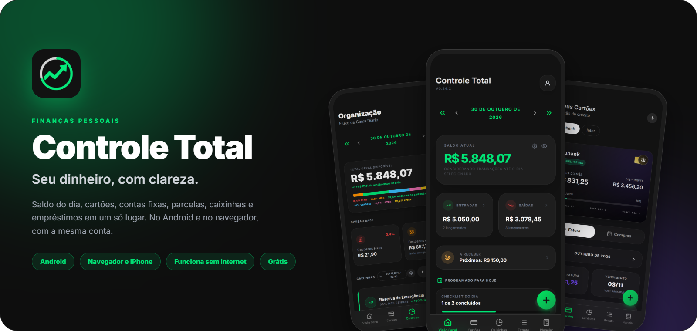
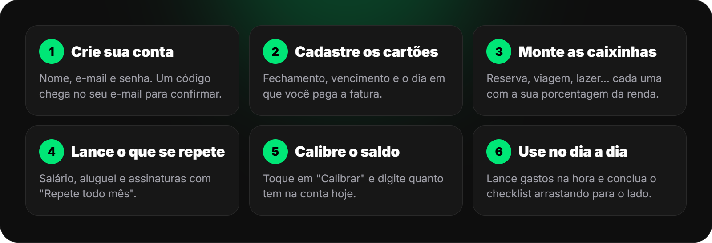
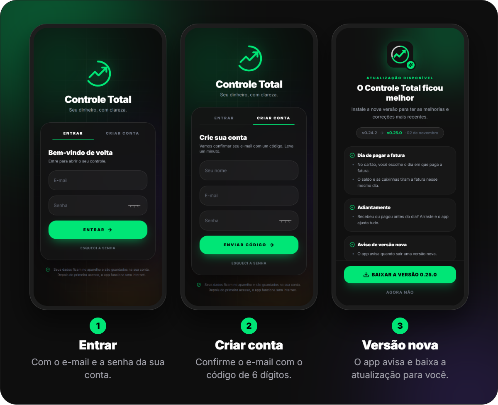
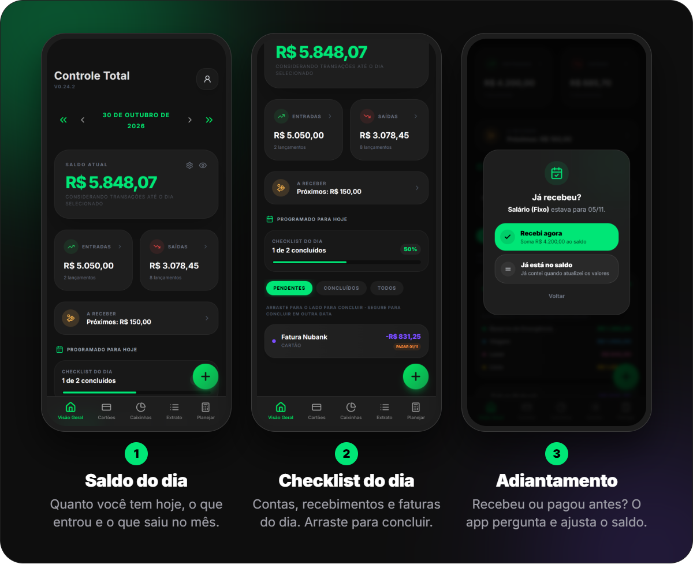
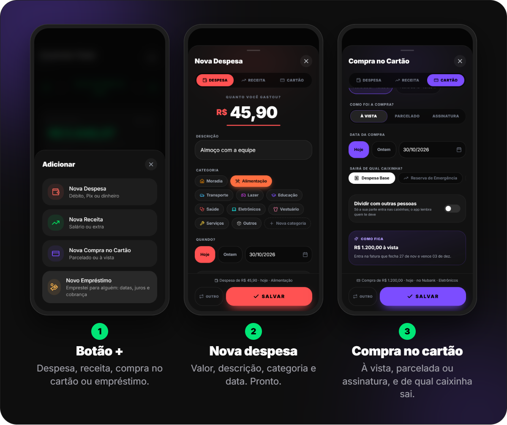
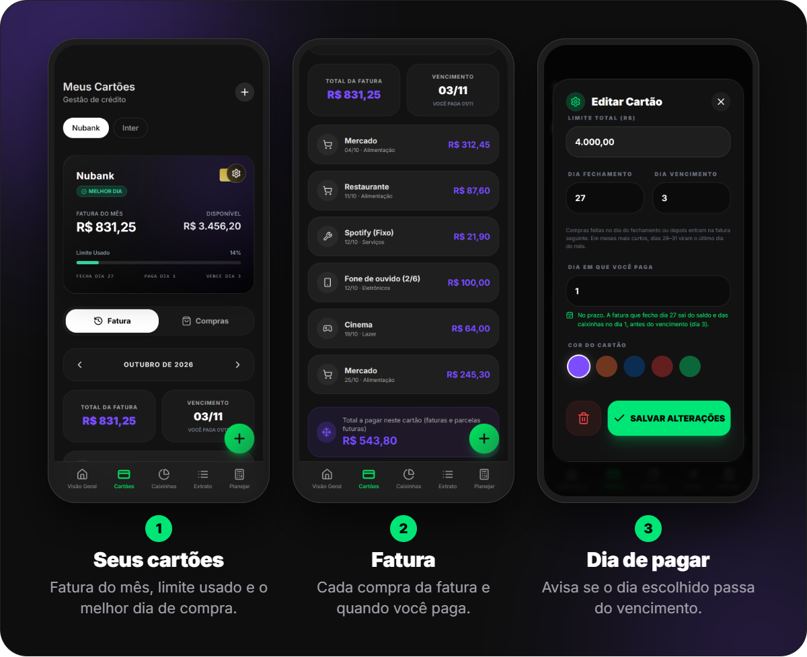
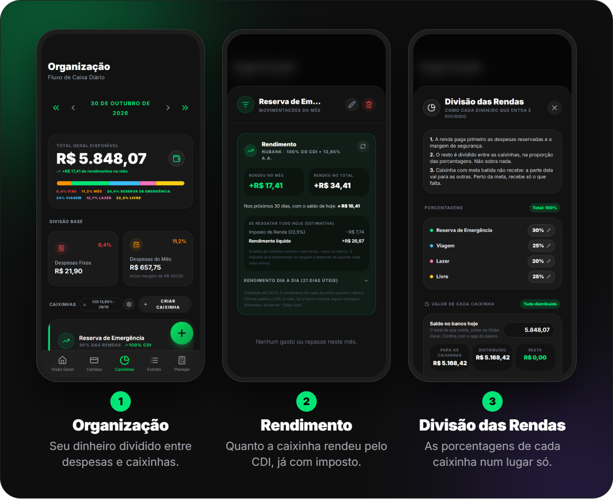
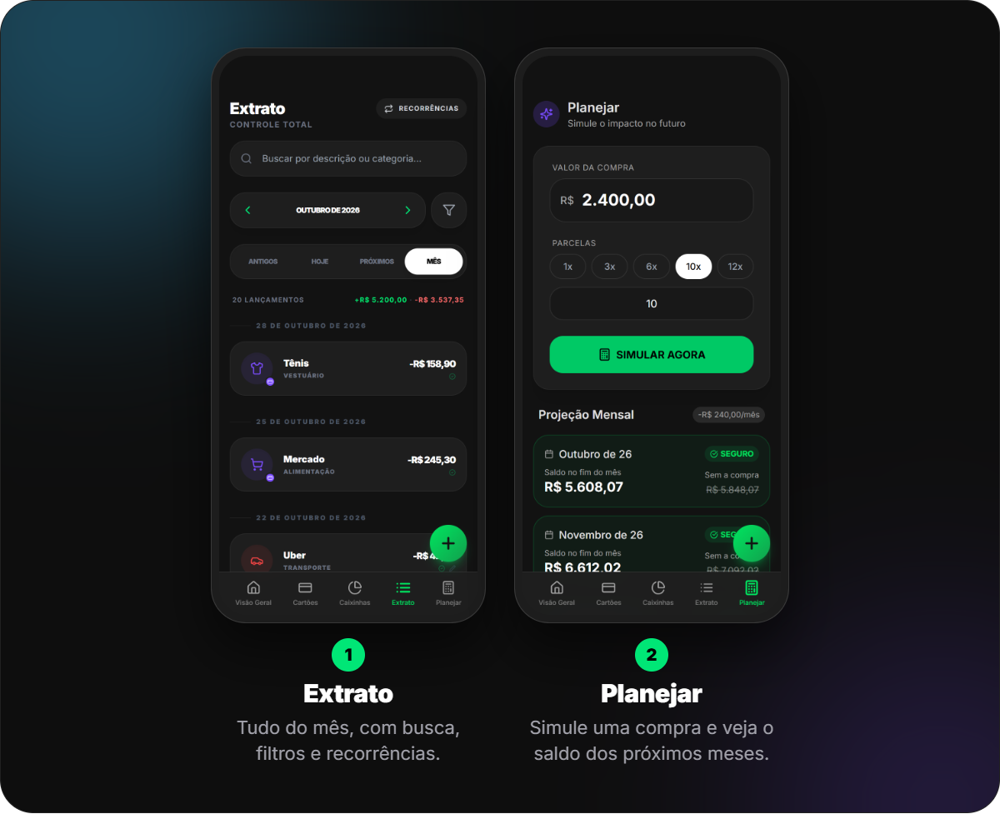
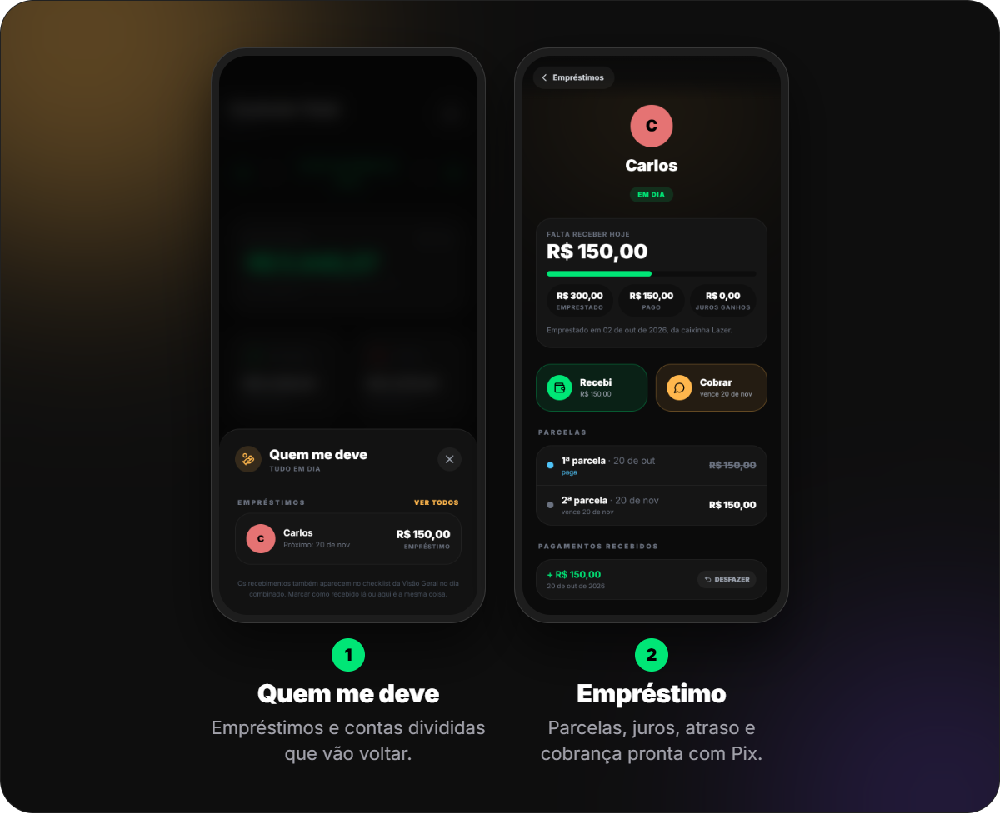
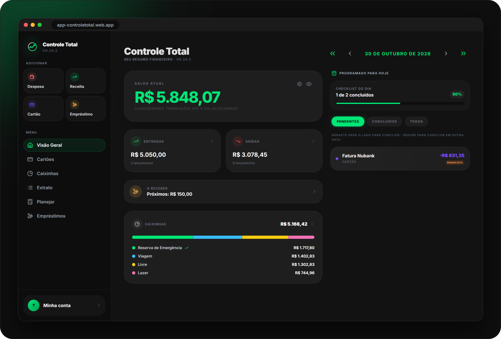

  

  
  &nbsp;
  

  <b>Controle Total</b> é um app de finanças pessoais para saber, todo dia, quanto dinheiro você tem de verdade: 
  saldo, cartões, contas que se repetem, parcelas, caixinhas e até quem está te devendo.

---

## Sumário

- [Instalar](#instalar)
- [Primeiros passos](#primeiros-passos)
- [Visão Geral](#visão-geral)
- [Lançar despesas, receitas e compras](#lançar-despesas-receitas-e-compras)
- [Cartões](#cartões)
- [Caixinhas](#caixinhas)
- [Extrato e Planejar](#extrato-e-planejar)
- [Empréstimos e contas divididas](#empréstimos-e-contas-divididas)
- [Conta, sincronização e atualizações](#conta-sincronização-e-atualizações)
- [No computador](#no-computador)
- [Gestos e atalhos](#gestos-e-atalhos)
- [Perguntas frequentes](#perguntas-frequentes)

---

## Instalar

### Android

1. Baixe o APK pelo link fixo: **https://app-controletotal.web.app/download/ControleTotal.apk**
   (ou em [Releases](../../releases/latest), arquivo `ControleTotal.apk`).
2. Abra o arquivo no celular. Se o Android perguntar, permita **instalar apps desta fonte**.
3. Toque em **Instalar** e abra o app.

> Já tem o app? Instale por cima. Seus dados ficam guardados na sua conta e nada se perde.
> A partir da versão 0.24, o próprio app avisa quando sai uma versão nova.

### iPhone, computador e tablet

Acesse **https://app-controletotal.web.app** e entre com a mesma conta.
No iPhone, toque em **Compartilhar → Adicionar à Tela de Início** para abrir como app, em tela cheia.

---

## Primeiros passos

O caminho para deixar o app pronto em poucos minutos:

| | O que fazer | Onde |
|:-:|---|---|
| **1** | **Crie sua conta** com nome, e-mail e senha. Um código de 6 dígitos chega no seu e-mail. | Tela de entrada → **Criar conta** |
| **2** | **Cadastre seus cartões**: limite, dia de fechamento, de vencimento e o **dia em que você paga**. | **Cartões** → **+** |
| **3** | **Monte as caixinhas** (Reserva, Viagem, Lazer...) e a porcentagem da renda de cada uma. | **Caixinhas** → **Criar caixinha** |
| **4** | **Lance o que se repete**: salário, aluguel, internet, assinaturas. Marque **Repete todo mês**. | Botão **+** |
| **5** | **Calibre o saldo**: digite quanto tem na conta hoje. O app passa a bater com o banco. | **Visão Geral** → **Calibrar** |
| **6** | **No dia a dia**, lance cada gasto na hora e conclua o checklist arrastando para o lado. | Botão **+** e **Visão Geral** |

---

## Visão Geral

A tela inicial responde a pergunta mais importante: **quanto eu tenho hoje?**

- **Saldo Atual**: o dinheiro da sua conta no dia escolhido. Use as setas da data para ver o saldo de qualquer dia, inclusive no futuro.
- **Entradas e Saídas**: o que entrou e saiu no mês. Toque para ver cada lançamento.
- **A receber**: empréstimos e contas divididas que alguém vai te devolver.
- **Checklist do dia**: contas, recebimentos e faturas daquele dia.
  - **Arraste para o lado** para marcar como feito.
  - **Segure** para concluir em outra data.
- **Adiantamento**: o salário caiu antes? A gasolina foi paga antes do dia? Vá até o dia previsto e arraste. O app pergunta se você **recebeu/pagou agora** (soma ou tira do saldo) ou se **já está no saldo** que você informou, e não conta de novo no dia previsto.
- **Olho** no canto do saldo: esconde os valores quando tem alguém olhando.
- **Engrenagem**: escolha quais caixinhas entram no saldo mostrado e recalibre o saldo.

---

## Lançar despesas, receitas e compras

Tudo começa no botão verde **+**:

| Tipo | Para quê |
|---|---|
| **Nova Despesa** | Débito, Pix ou dinheiro. Escolha a categoria e de qual caixinha o dinheiro sai. |
| **Nova Receita** | Salário, freela, venda. Dá para escolher **para qual caixinha** o dinheiro vai, ou deixar dividir pelas porcentagens. |
| **Nova Compra no Cartão** | À vista, **parcelada** ou **assinatura**. O app coloca cada parcela na fatura certa. |
| **Novo Empréstimo** | Dinheiro que você emprestou para alguém (veja [Empréstimos](#empréstimos-e-contas-divididas)). |

Mais coisas que dá para fazer ao lançar:

- **Repete todo mês**: salário, aluguel e assinaturas aparecem sozinhos nos meses seguintes.
- **Dividir com outras pessoas**: a conta de luz dividida com quem mora com você, ou uma compra no seu cartão que um amigo vai pagar metade. Só a **sua parte** pesa nas caixinhas, e o app lembra quem te deve.
- **Data**: Hoje, Ontem ou qualquer dia, inclusive no futuro, para planejar.

---

## Cartões

- **Fatura do mês**, **limite disponível** e quanto do limite está usado.
- **Melhor dia**: depois do fechamento, o que você compra só entra na fatura seguinte (mais prazo para pagar).
- **Fatura** e **Compras**: veja cada compra da fatura, as parcelas que ainda faltam e as assinaturas.
- **Dia em que você paga**: o app tira a fatura do saldo e das caixinhas **no dia que você paga de verdade**.
  - Se você escolhe um dia depois do vencimento, o app avisa: o banco cobra multa e juros.
  - Se cai uma renda no dia de pagar, ela paga a fatura. Se não for suficiente, a diferença já fica guardada antes.

---

## Caixinhas

As caixinhas dividem o seu dinheiro em objetivos, como envelopes:

- **Cada renda paga primeiro as contas** (fixas e do mês) e a **margem de segurança**. O que sobra é dividido entre as caixinhas pelas porcentagens.
- **Metas**: a caixinha que bateu a meta para de receber e a parte dela vai para as outras.
- **Saldo hoje**: informe quanto tem de verdade em cada caixinha, e o app ajusta.
- **Repasses**: mova dinheiro de uma caixinha para outra.
- **Rendimento pelo CDI**: diga quanto a caixinha rende (ex.: 100% do CDI) e veja quanto rendeu no mês, já com o imposto estimado.
- **Divisão das Rendas**: todas as porcentagens num lugar só, com o valor de cada caixinha e um simulador de renda.
- Gastos lançados numa caixinha saem dela. Gastos sem caixinha saem das despesas.

---

## Extrato e Planejar

**Extrato**
- Todos os lançamentos por mês, agrupados por dia, com o total de entradas e saídas.
- **Busca** por descrição ou categoria e **filtros** (antigos, hoje, próximos, mês).
- **Recorrências**: veja e edite tudo que se repete todo mês.

**Planejar**
- Digite o valor de uma compra e em quantas parcelas.
- O app mostra o saldo de cada mês **com e sem a compra**, e avisa se ela cabe no seu bolso.

---

## Empréstimos e contas divididas

- **Quem me deve**: empréstimos e contas divididas que ainda vão voltar, com o próximo vencimento.
- **Empréstimo**: valor, datas das parcelas, **juros** (fixos ou por mês) e regras de **atraso** (multa e juros).
- **De onde saiu o dinheiro**: de uma caixinha ou do dinheiro livre. Ele fica marcado como emprestado até voltar.
- **Cobrar**: monta uma mensagem educada com o valor e a sua **chave Pix**, pronta para mandar pelo WhatsApp.
- **Recebi**: registre o pagamento (inteiro ou parte). Também dá para concluir pelo checklist.
- Lembretes no celular no dia de receber.

---

## Conta, sincronização e atualizações

- **Conta própria**: seus dados ficam no celular **e** guardados na sua conta. Trocou de celular? Entre com o mesmo e-mail e tudo volta.
- **Funciona sem internet**: lance normalmente. Quando a internet volta, o app sincroniza sozinho.
- **Vários aparelhos**: celular e computador com a mesma conta, sempre iguais.
- **Perfil** (ícone no canto da Visão Geral):
  - nome, troca de senha e e-mail da conta;
  - **backup** em arquivo e **restaurar**;
  - **planilha** em Excel por mês e por assunto;
  - **chave Pix** usada nas cobranças;
  - **lembretes** das contas, faturas e de quem te deve, mesmo com o app fechado.
- **Atualizações**: quando sai uma versão nova, o app mostra as novidades e o botão para baixar. É só instalar por cima.

---

## No computador

Em **https://app-controletotal.web.app**, telas largas ganham uma barra lateral com atalhos (despesa, receita, cartão, empréstimo), o menu das telas e o seu perfil. As telas se organizam em colunas, aproveitando o espaço.

---

## Gestos e atalhos

| Gesto | O que faz |
|---|---|
| **Arrastar para o lado** um item do checklist | Conclui (ou desfaz) |
| **Segurar** um item do checklist | Conclui em outra data |
| **Arrastar** um item de um dia que ainda não chegou | Adiantamento: recebi/paguei antes |
| **Setas da data** na Visão Geral | Um dia (‹ ›) ou um mês (« ») para frente ou para trás |
| **Olho** no saldo | Esconde os valores |
| **Voltar** do Android | Fecha a janela aberta, volta para a Visão Geral e depois minimiza |

---

## Perguntas frequentes

<b>O saldo do app não bate com o do banco. O que eu faço?</b>

 
Na Visão Geral, toque na engrenagem do saldo e em <b>Recalibrar saldo</b>. Digite quanto tem na conta agora. O app ajusta tudo a partir dali, sem apagar nada.

<b>Recebi o salário antes do dia. Como lanço?</b>

 
Vá até o dia em que ele estava previsto e arraste o item para o lado. Escolha <b>Recebi agora</b> (soma ao saldo hoje) ou <b>Já está no saldo</b> (se você já tinha contado ao atualizar os valores). Ele não entra de novo no dia previsto.

<b>Por que a fatura sai do saldo num dia diferente do vencimento?</b>

 
Porque o app usa o <b>dia em que você paga</b>, informado no cartão. Se você paga no dia 1 e a fatura vence no dia 3, ela sai no dia 1. Para mudar, toque na engrenagem do cartão.

<b>Meus dados estão seguros?</b>

 
Cada conta só enxerga os próprios dados. A conexão é protegida e a senha nunca fica guardada no app. Você também pode salvar um backup em arquivo quando quiser, pelo Perfil.

<b>Troquei de celular. Perco tudo?</b>

 
Não. Instale o app no celular novo e entre com o mesmo e-mail e senha. Os dados voltam da sua conta.

<b>O Android diz que o app é de fonte desconhecida.</b>

 
É normal para apps instalados fora da Play Store. Permita <b>instalar apps desta fonte</b> só para o navegador ou o gerenciador de arquivos que abriu o APK.

<b>Como atualizo o app?</b>

 
A partir da versão 0.24, o app avisa sozinho quando sai uma versão nova e mostra o botão para baixar. Se preferir, baixe pelo link fixo <a href="https://app-controletotal.web.app/download/ControleTotal.apk">ControleTotal.apk</a> e instale por cima.

---

   
  <b>Controle Total</b> · feito por Felipe Kevin 
  As telas mostradas acima usam dados fictícios.

